# SONICFORGE AI — Professional AI Music & Sound Studio

<div align="center">


**One Creative Studio. Endless Musical Possibilities.**

A unified, production-grade creative audio SaaS combining generative AI music synthesis, vocal song generation, sound effects creation, neural stem separation, and browser-native Indian classical music practice tools in a single workspace.

*Built for the **Generative AI Clash** at **Techno India University School of the Future**, in association with **GeeksforGeeks**.*

[Overview](#-project-overview) • [Key Features](#-core-features-walkthrough) • [Architecture](#-system-architecture) • [Setup Guide](#-step-by-step-setup-guide) • [API Integrations](#-api-integrations--environment-variables) • [Troubleshooting](#-troubleshooting--faq)

</div>

---

## 📑 Table of Contents

- [Project Overview](#-project-overview)
  - [The Problem](#the-problem)
  - [The SonicForge Solution](#the-sonicforge-solution)
  - [Target Users](#target-users)
- [Core Features Walkthrough](#-core-features-walkthrough)
  - [1. AI Music Studio](#1-ai-music-studio)
  - [2. AI Vocal Song Generator & Custom Songwriter](#2-ai-vocal-song-generator--custom-songwriter)
  - [3. Sound Effects & Foley Studio](#3-sound-effects--foley-studio)
  - [4. Neural Analog Stem Lab](#4-neural-analog-stem-lab)
  - [5. Authentic Tanpura Drone](#5-authentic-tanpura-drone)
  - [6. Authentic Tabla & Taal Studio](#6-authentic-tabla--taal-studio)
  - [7. Alankar Studio & Custom Sargam Builder](#7-alankar-studio--custom-sargam-builder)
  - [8. Sonic Assistant (Voice Copilot)](#8-sonic-assistant-voice-copilot)
  - [9. Browser-Native Instrument & Acoustic Tools](#9-browser-native-instrument--acoustic-tools)
  - [10. Authentication, Audio Library & Cloud Storage](#10-authentication-audio-library--cloud-storage)
  - [11. Diagnostics & Support Center](#11-diagnostics--support-center)
- [Screenshots & Visual Documentation](#-screenshots--visual-documentation)
- [System Architecture](#-system-architecture)
- [Technology Stack](#-technology-stack)
- [Step-by-Step Setup Guide](#-step-by-step-setup-guide)
  - [Prerequisites](#prerequisites)
  - [1. Clone Repository](#1-clone-repository)
  - [2. Install Dependencies](#2-install-dependencies)
  - [3. Environment Configuration](#3-environment-configuration)
  - [4. Run Local Development Server](#4-run-local-development-server)
  - [5. Production Build Verification](#5-production-build-verification)
- [API Integrations & Environment Variables](#-api-integrations--environment-variables)
  - [Environment Variables Reference](#environment-variables-reference)
  - [Provider Details & Fallback Behaviors](#provider-details--fallback-behaviors)
- [Project Directory Structure](#-project-directory-structure)
- [Security & Data Protection Model](#-security--data-protection-model)
- [Troubleshooting & FAQ](#-troubleshooting--faq)
- [Hackathon Submission Highlights](#-hackathon-submission-highlights)
- [Contributing & License](#-contributing--license)

---

## 💡 Project Overview

### The Problem

Modern music creators, sound designers, and vocal students face a fragmented creative workflow:
- Generating instrumental tracks requires one expensive AI subscription.
- Splitting audio stems requires uploading private files to third-party isolation websites.
- Generating foley sound effects requires searching through disparate sound asset libraries.
- Practicing classical Indian swaras, scales, and talas requires separate hardware devices (electronic tanpuras, tabla machines) or ad-supported mobile apps.
- Tuning acoustic instruments and testing vocal stability requires standalone tuner utilities.

Creatives waste valuable time juggling disconnected tabs, moving audio files back and forth, and managing conflicting subscriptions.

### The SonicForge Solution

**SonicForge AI** integrates the entire audio lifecycle into a single, cohesive, modern web application:
1. **Generative Creation:** Text-to-music, vocal song generation, AI lyric composition, and foley sound effect synthesis.
2. **Post-Production Separation:** Fast neural audio stem separation into isolated vocal, drum, bass, and accompaniment tracks with in-browser multi-channel mixing.
3. **Acoustic Practice & Theory:** 100% browser-native physical modeling of Indian classical Tanpura drones, 8 classical Tabla rhythmic cycles, chromatic instrument tuning, Sargam exercises, and interactive loop building.

> [!NOTE]
> SonicForge AI is built as an accessible, rapid-ideation music creation sandbox and acoustic learning companion. It does not claim to replace multi-thousand-dollar desktop Digital Audio Workstations (DAWs) like Pro Tools or Logic Pro, but rather accelerates the ideation and practice process.

### Target Users

- **Independent Musicians & Songwriters:** Rapidly generate backing tracks, explore vocal ideas, and isolate instrumental stems.
- **Game Developers & Filmmakers:** Generate custom cinematic cues, level loops, and contextual foley sound effects without licensing royalties.
- **Podcasters & Content Creators:** Produce custom theme music, stingers, background transitions, and voice intros.
- **Indian Classical Music Students & Vocalists:** Practice riyaaz with authentic Jawari Tanpura drones, accurate Tabla taal accompaniment, and guided Sargam Alankars.

---

## 🌟 Core Features Walkthrough

### 1. AI Music Studio
*Route: `/studio` | Status: Available & Tested (requires `ELEVENLABS_API_KEY`)*

- **Production Integration:** Directly connects via server-side routes to the official ElevenLabs Music API (`music_v2`).
- **Comprehensive Musical Controls:** Prompt input, genre selection, mood styling, tempo/BPM target, multi-instrument selector, duration slider (15s–60s), and instrumental-only toggle.
- **8 Curated Presets:** Instant configuration for *Cinematic Orchestral*, *Retrowave Synth*, *Ambient Dreamscape*, *Lo-Fi Study Beat*, *Podcast Stinger*, *Game Boss Battle*, *Neo-Soul Groove*, and *Cyberpunk Action*.
- **Professional Audio Player:** Docked persistent player with seekable scrubbing, volume control, playback rate adjustment (0.5x to 2.0x), one-click MP3 download, and **real Web Audio API PCM waveform decoding** (extracts true audio amplitude peaks rather than synthetic CSS animations).

### 2. AI Vocal Song Generator & Custom Songwriter
*Route: `/custom-song` | Status: Available & Tested (requires `ELEVENLABS_API_KEY` + `GEMINI_API_KEY` for lyric assistance)*

- **Dual-Mode Songwriting:** Generates full songs with vocal melodies or pure instrumental tracks.
- **Structure-Aware Composition:** Supports song sections (`[Intro]`, `[Verse 1]`, `[Chorus]`, `[Bridge]`, `[Outro]`).
- **AI Lyric Co-Writer:** Integrated with Google Gemini via `/api/lyrics/generate` to draft rhyming, rhythmically balanced lyrics across diverse genres, themes, and emotional tones.
- **Vocal Style Directives:** Fine-tune vocal delivery (e.g., soulful female vocals, gritty male rock vocals, ethereal harmonies, energetic pop delivery).

### 3. Sound Effects & Foley Studio
*Route: `/sfx` | Status: Available & Tested (requires `ELEVENLABS_API_KEY`)*

- **Production Integration:** Connects to the official ElevenLabs Sound Generation API (`eleven_text_to_sound_v2`).
- **Precise Acoustic Controls:** Duration slider (0.5s to 22.0s) and prompt influence slider (0.1 creative exploration to 0.9 strict adherence).
- **Seamless Looping:** Toggle seamless loop rendering to create continuous ambient textures (e.g., spaceship engine hum, rainy city night, crackling campfire).

### 4. Neural Analog Stem Lab
*Route: `/stems` | Status: Production-Ready & Tested (requires `NEURALANALOG_API_KEY`)*

- **Neural Stem Separation:** Isolates complex mixed audio into discrete stems (Vocals, Drums, Bass, Other/Guitar/Piano) using Neural Analog Cloud AI.
- **Client-Side Web Audio Optimizer:** Automatically compresses audio files larger than 4.2 MB into 16-bit PCM WAV directly in the browser using [src/lib/wav-encoder.ts](file:///c:/Users/RONAK/New%20folder%20(16)/src/lib/wav-encoder.ts), eliminating Vercel's 4.5 MB serverless body limits (413 errors).
- **Decoupled Asynchronous Architecture:** Bypasses serverless timeouts by splitting the workflow into `/split` (instant upload stream), `/audio-status` (readiness check), `/create` (job trigger), and `/status` (non-blocking backoff polling).
- **Hardware Queue Tracking:** Real-time elapsed timer and provider status indicator ("Waiting in queue for hardware availability...").
- **Session Persistence:** Saves active job state in `localStorage` (`sonicforge_stem_job`), allowing seamless tracking across page refreshes.
- **Multi-Source Imports:** Supports direct audio file uploads as well as online links from Suno, Udio, Spotify, and YouTube via `/api/stems/link`.
- **In-Browser Multi-Track Mixer:** Features individual Solo, Mute, Volume faders, master waveform, and direct WAV stem downloads via secure signed S3 redirects (`/api/stems/download/[id]`).

### 5. Authentic Tanpura Drone
*Route: `/practice` | Status: 100% Browser-Native (Zero API Keys Required)*

- **Physical Acoustic Modeling:** Synthesized using the native Web Audio API in [src/lib/indian-audio-engine.ts](file:///c:/Users/RONAK/New%20folder%20(16)/src/lib/indian-audio-engine.ts).
- **Jawari Bridge Filter:** Accurately emulates the characteristic buzzing overtone spectrum of an acoustic curved bridge using a 2100 Hz bandpass formant filter ($Q = 3.8$) combined with a 3200 Hz body lowpass filter.
- **Microtonal Beating:** Jod Sa strings are tuned with a subtle 0.6 Hz micro-detune factor ($1.0025 \times \text{Sa}$), producing the natural acoustic shimmer of real silk and bronze strings.
- **String Configurations:** Switch between 4-string and 5-string modes (incorporating Mandra Pancham / Kharaj root).
- **Tuning Options:** Selectable first-string tuning: **Pa** (Standard), **Ma** (for ragas omitting Pa like Malkauns), or **Ni** (for Marwa and Puriya).
- **Interactive Controls:** All 12 chromatic tonic pitches (C through B), pluck tempo control (0.8s–2.2s), volume slider, and a live visualizer showing which wire is currently vibrating.

### 6. Authentic Tabla & Taal Studio
*Route: `/practice` | Status: 100% Browser-Native (Zero API Keys Required)*

- **Physical Acoustic Drum Synthesis:**
  - **Dayan (Treble):** Tuned to the selected Sa tonic. Accurately synthesizes metallic rim strikes (**Na/Ta** on chanti), open strokes (**Tin/Ti** between syahi and maidan), singing center resonances (**Tun**), and muted dry damping (**Te**).
  - **Bayan (Bass):** Features continuous wrist pressure pitch-glides (**Ge/Ghe** meend sliding from 68 Hz to 84 Hz down to 60 Hz) and flat palm slaps (**Ke/Ka/Kat** at 110 Hz).
  - **Compound Bols:** Accurate multi-part timing for `Dha` (Ge + Na), `Dhin` (Ge + Tin), `DhaGe`, `GaDi`, `GeNe`, `KiTe`, `TiTe`, `Tirakita`, and expressive avagraha pauses (`-`).
- **Drift-Free Audio Clock:** Implements Chris Wilson's Web Audio lookahead scheduling pattern (120ms lookahead in 25ms intervals), preventing rhythmic jitter caused by UI rendering or tab backgrounding.
- **8 Classical Hindustani Taals:**
  1. **Teentaal** (16 Matras: 4+4+4+4)
  2. **Ektaal** (12 Matras: 2+2+2+2+2+2)
  3. **Jhaptaal** (10 Matras: 2+3+2+3)
  4. **Rupak** (7 Matras: 3+2+2, starts on Khaali)
  5. **Keharwa** (8 Matras: 4+4)
  6. **Dadra** (6 Matras: 3+3)
  7. **Deepchandi** (14 Matras: 3+4+3+4 with rests)
  8. **Chautaal** (12 Matras: 2+2+2+2+2+2 Dhrupad pakhawaj)
- **Visual Beat Counter:** Displays divisions (vibhaags), dynamic beat counter, and distinctive badges for Sam (`X`), Taali (`2`, `3`, `4`), and Khaali (`0`).

### 7. Alankar Studio & Custom Sargam Builder
*Route: `/practice` | Status: 100% Browser-Native (Zero API Keys Required)*

- **8 Standard Classical Exercises:**
  1. *Shuddha Swara Aroha & Avaroha* (Fundamental ascending and descending 7-note scale)
  2. *Double Swara / Jod Swara* (Repeated note stability and breath control)
  3. *Triplets / Trika* (3-note step progressions)
  4. *Quads / Chatur Swara* (4-note step progressions for tempo agility)
  5. *Skipping Intervals / Antar* (Intervals of thirds for ear training)
  6. *Palta Zigzag Turnarounds* (Improvisational turnaround patterns)
  7. *Wide Intervals* (Consonant fourths and fifths jumps)
  8. *Progressive Wave Patterns* (5-note wave steps traversing the saptak)
- **Dual-Reed Harmonium Voice:** Real-time synthesis with slight chorus detune and resonant lowpass filtering (`SargamSynthEngine`).
- **Custom Alankar Builder:**
  - Interactive on-screen Swara Palette: `Sa`, `re` (komal), `Re` (shuddha), `ga` (komal), `Ga` (shuddha), `Ma` (shuddha), `ma'` (teevra), `Pa`, `dha` (komal), `Dha` (shuddha), `ni` (komal), `Ni` (shuddha), and `Sa'` (taar).
  - Deterministic text parser (`parseSargamPhrase`, `validateSargamPhrase`) that validates user-typed text, flags syntax errors, and computes accurate semitone offsets.
  - Live audio preview and `localStorage` persistence (`sonicforge_custom_alankars`).

### 8. Sonic Assistant (Voice Copilot)
*Route: `/assistant` | Status: Available & Tested (requires `RIME_TTS_API_KEY` for voice output)*

- **Conversational Studio Copilot:** Offers guidance on prompt phrasing, musical genres, arrangement structure, and troubleshooting.
- **Natural Voice Synthesis:** Powered by the official Rime Coda TTS API (`https://users.rime.ai/v1/rime-tts`) with selectable voice speakers (*Astra*, *Nadi*, *Marcus*).
- **Hands-Free Microphone Input:** Browser-native Web Speech Recognition API with automatic transcript formatting and typed text fallback.

### 9. Browser-Native Instrument & Acoustic Tools
*Status: 100% Browser-Native (Zero API Keys Required)*

- **SonicTune Chromatic Tuner (`/tuner`):** Pitch detection via the Pitchy autocorrelation algorithm, live cents deviation gauge, target frequency indicator, and instrument presets (Guitar, Bass, Ukulele, Violin, Tanpura).
- **Sonic Harmonium (`/harmonium`):** Virtual dual-reed keyboard with Sargam overlay, laptop QWERTY key mapping, and Web MIDI API input support.
- **Vocal Pitch Coach (`/vocal-coach`):** Real-time microphone vocal pitch tracking showing pitch stability, note deviation, and target reference lines.
- **Sonic Loop Lab (`/loop-lab`):** Multi-track timeline loop arranger with microphone audio recording, track volume/pan, and WAV file export.
- **Chord & Scale Explorer (`/chords`):** Theory reference supporting Western major/minor modes, diatonic harmony, 10 Indian Thaats, piano visualizer, and standard MIDI export.

### 10. Authentication, Audio Library & Cloud Storage
*Routes: `/login`, `/register`, `/library`, `/projects` | Status: Available (requires Firebase)*

- **Firebase Authentication:** Email/Password registration and login, Google OAuth popup sign-in, and persistent user sessions.
- **Cloud Firestore Storage:** Per-user security rules (`firestore.rules`) isolating tracks, sound effects, project workspaces, and user profiles.
- **Firebase Storage:** Scoped audio file uploads (`storage.rules`) with size limits (<25 MB) and MIME-type checks.
- **Local Audio Library:** Search by prompt, filter by genre, toggle favorites, sort by date/duration, and single-click "Tweak & Regenerate" back into the studio console.

### 11. Diagnostics & Support Center
*Routes: `/diagnostics`, `/support` | Status: Available & Tested*

- **Zero-Leakage Integration Diagnostics:** Server-side connectivity and schema validation for Firebase, ElevenLabs, Rime TTS, and Neural Analog. Performs read-only non-destructive checks that never trigger paid billing or expose private keys.
- **Customer Support Desk:** Searchable knowledge base addressing API limits, browser autoplay permissions, audio encoding, and a direct ticket logger saving to Cloud Firestore with email dispatch to `support@sonicforge.ai`.

---

## 📸 Screenshots & Visual Documentation

For a visual demonstration of SonicForge AI in action, refer to the [Screenshot Asset Directory](docs/screenshots/README.md).

```
docs/screenshots/
├── dashboard.png          # Main studio overview, quick metrics & player
├── music-studio.png       # ElevenLabs prompt console, presets & waveform
├── stem-lab.png           # Neural Analog 4-stem mixer & WAV downloads
├── practice-studio.png    # Jawari Tanpura, Tabla cycles & Alankar builder
└── sonic-assistant.png    # Rime Coda voice copilot & microphone dialogue
```

> [!TIP]
> **To add your own screenshots:**
> 1. Start the local server (`npm run dev`) and navigate to the application.
> 2. Capture clean 1280x800 desktop screenshots in **Dark Mode**.
> 3. Save images into `docs/screenshots/` matching the filenames above.
> 4. GitHub will automatically render them inside your repository documentation.

---

## 🏗️ System Architecture

```mermaid
flowchart TD
    subgraph Client["Browser Client (Next.js 14 / React 18 / Tailwind)"]
        UI["Studio UI & Dashboards"]
        WebAudioEngine["Web Audio API Engine\n(Tanpura, Tabla, Harmonium, Pitchy)"]
        WAVEncoder["Client-Side PCM WAV Optimizer\n(src/lib/wav-encoder.ts)"]
        AudioPlayer["Docked Audio Player\n(Real PCM Waveform Decoding)"]
        SpeechIn["Web Speech API (Microphone Input)"]
    end

    subgraph ServerRoutes["Next.js Serverless API Layer (/api/*)"]
        SplitRoute["POST /api/stems/split\n(Fast Streaming Upload)"]
        CreateRoute["POST /api/stems/create\n(Stem Separation Trigger)"]
        StatusRoute["GET /api/stems/status\n(Non-blocking Backoff Polling)"]
        MusicRoute["POST /api/music/generate\n(ElevenLabs Music Proxy)"]
        SFXRoute["POST /api/sound-effects/generate\n(ElevenLabs SFX Proxy)"]
        VoiceRoute["POST /api/voice/speak\n(Rime Coda TTS Proxy)"]
        LyricsRoute["POST /api/lyrics/generate\n(Gemini Lyric Assistant)"]
        DiagRoute["GET /api/diagnostics\n(Zero-Leakage Health Check)"]
    end

    subgraph ExternalProviders["Configured External Services"]
        Firebase["Google Firebase\n(Auth, Firestore, Cloud Storage)"]
        ElevenLabs["ElevenLabs Cloud API\n(Music v2 & Sound Effects v2)"]
        NeuralAnalog["Neural Analog Cloud API\n(Audio Source Separation)"]
        RimeTTS["Rime Coda TTS API\n(Neural Voice Synthesis)"]
        Gemini["Google Gemini API\n(Structured Lyrics & Music Copilot)"]
    end

    UI -->|Local DSP Processing| WebAudioEngine
    UI -->|Audio Decoded Waveforms| AudioPlayer
    UI -->|Large Audio Files > 4.2MB| WAVEncoder
    WAVEncoder -->|Optimized WAV Stream| SplitRoute

    UI -->|User Registration & Login| Firebase
    UI -->|Fetch User Tracks & Projects| Firebase
    UI -->|Microphone Input| SpeechIn

    UI -->|Music Generation Request| MusicRoute
    UI -->|Sound Effect Request| SFXRoute
    UI -->|Voice Chat Request| VoiceRoute
    UI -->|Lyric Co-Writer Request| LyricsRoute
    UI -->|Stem Extraction Request| CreateRoute
    UI -->|Poll Separation Status| StatusRoute

    MusicRoute -->|xi-api-key| ElevenLabs
    SFXRoute -->|xi-api-key| ElevenLabs
    SplitRoute -->|X-API-KEY| NeuralAnalog
    CreateRoute -->|X-API-KEY| NeuralAnalog
    StatusRoute -->|X-API-KEY| NeuralAnalog
    VoiceRoute -->|Bearer Token| RimeTTS
    LyricsRoute -->|API Key| Gemini
    DiagRoute -.->|Read-Only Health Check| ElevenLabs
    DiagRoute -.->|Read-Only Health Check| RimeTTS
    DiagRoute -.->|Read-Only Health Check| NeuralAnalog
```



### Architectural Highlights

1. **Strict Credential Isolation:** Secret API keys (`ELEVENLABS_API_KEY`, `NEURALANALOG_API_KEY`, `RIME_TTS_API_KEY`, `GEMINI_API_KEY`) reside **strictly on the server-side runtime**. They are never bundled into client JavaScript or sent over network responses.
2. **Client-Side Heavy DSP:** Tanpura synthesis, Tabla physical modeling, pitch tracking, and harmonium rendering execute entirely inside the client's browser using the native Web Audio API, costing zero server bandwidth and zero provider quota.
3. **Optimized Serverless Dataflow:** File uploads destined for stem separation are compressed in the browser before dispatch, preventing serverless memory spikes and 413 "Payload Too Large" rejections.

---

## 💻 Technology Stack

| Category | Technologies | Purpose in SonicForge AI |
|---|---|---|
| **Frontend Framework** | Next.js 14 (App Router), React 18 | SSR, dynamic routing, layout streaming, and client-side interactivity |
| **Language & Tooling** | TypeScript 5.6 | Strict compile-time type safety across audio engines, API routes, and data schemas |
| **Styling & Design** | Tailwind CSS 3.4, Lucide Icons | Responsive design system, dark/light theme support, accessible studio controls |
| **Browser Audio DSP** | Web Audio API, Tone.js, Pitchy | Real-time Tanpura/Tabla synthesis, pitch autocorrelation, and waveform decoding |
| **Music Generation** | ElevenLabs Music API (`music_v2`) | Text-to-music generation with genre, mood, duration, and tempo parameters |
| **Sound Effects** | ElevenLabs Sound Generation API (`eleven_text_to_sound_v2`) | Text-to-foley sound effects with prompt influence and seamless looping |
| **Stem Separation** | Neural Analog API (`/from-file`, `/from-link`, `/create-stems`) | Cloud-based 2/4/5 stem isolation for vocals, drums, bass, and accompaniment |
| **Voice Synthesis** | Rime Coda TTS API (`coda.api.rime.ai`) | Low-latency natural voice output for the Sonic Assistant studio copilot |
| **AI Co-Writer** | Google Gemini API (`gemini-1.5-flash` / `gemini-pro`) | Semantic lyric generation, verse/chorus structure planning, and prompt crafting |
| **Authentication & DB** | Google Firebase 10 (Auth, Cloud Firestore, Storage) | User authentication, track metadata storage, project folders, and audio storage |

---

## 🚀 Step-by-Step Setup Guide

### Prerequisites

- **Node.js**: `v18.17.0` or higher (`v20+` LTS recommended).
- **npm**: Package manager bundled with Node.js.
- **Git**: Distributed version control system.
- *(Optional)* Provider API keys for ElevenLabs, Neural Analog, Rime TTS, and Firebase.

### 1. Clone Repository

```bash
git clone https://github.com/RonakBairagi/SONICFORGE_AI.git
cd SONICFORGE_AI
```

### 2. Install Dependencies

```bash
npm install
```

> [!TIP]
> **Windows PowerShell Users:** If PowerShell security policies restrict running local scripts, execute commands via `npm.cmd install` or run PowerShell with `Set-ExecutionPolicy -Scope Process -ExecutionPolicy Bypass`.

### 3. Environment Configuration

Copy the template file to create your local environment configuration:

```bash
cp .env.example .env.local
```

Open `.env.local` in your editor and configure your credentials. Refer to the [Environment Variables Reference](#environment-variables-reference) table below for guidance.

### 4. Run Local Development Server

```bash
npm run dev
```

Open [http://localhost:3000](http://localhost:3000) in your web browser. The application will load immediately with the interactive Welcome Screen.

### 5. Production Build Verification

To verify that all 30 pages and serverless API routes compile cleanly for production deployment:

```bash
npm run build
```

To run the optimized production server locally:

```bash
npm start
```

---

## 🔑 API Integrations & Environment Variables

### Environment Variables Reference

| Variable Name | Purpose | Required | Where to Obtain Key |
|---|---|---|---|
| `NEXT_PUBLIC_FIREBASE_API_KEY` | Firebase Web API Key for client SDK | **Optional\*** | [Firebase Console](https://console.firebase.google.com/) &rarr; Project Settings |
| `NEXT_PUBLIC_FIREBASE_AUTH_DOMAIN` | Firebase Auth Domain | **Optional\*** | Firebase Console &rarr; Project Settings |
| `NEXT_PUBLIC_FIREBASE_PROJECT_ID` | Firebase Project ID | **Optional\*** | Firebase Console &rarr; Project Settings |
| `NEXT_PUBLIC_FIREBASE_STORAGE_BUCKET` | Firebase Cloud Storage bucket URL | **Optional\*** | Firebase Console &rarr; Storage |
| `NEXT_PUBLIC_FIREBASE_MESSAGING_SENDER_ID` | Cloud Messaging Sender ID | **Optional\*** | Firebase Console &rarr; Project Settings |
| `NEXT_PUBLIC_FIREBASE_APP_ID` | Firebase Web App ID | **Optional\*** | Firebase Console &rarr; Project Settings |
| `NEXT_PUBLIC_FIREBASE_MEASUREMENT_ID` | Google Analytics Measurement ID | Optional | Firebase Console &rarr; Analytics |
| `ELEVENLABS_API_KEY` | Used server-side for AI Music & Sound Effects | **Optional\*** | [ElevenLabs Developer Dashboard](https://elevenlabs.io/) &rarr; Profile &rarr; API Keys |
| `NEURALANALOG_API_KEY` | Used server-side for Stem Separation | **Optional\*** | [Neural Analog API Portal](https://api.neuralanalog.com/) |
| `AUDIO_SEPARATION_API_KEY` | Alias fallback for Neural Analog key | Optional | Neural Analog API Portal |
| `RIME_TTS_API_KEY` | Used server-side for Sonic Assistant Voice Output | **Optional\*** | [Rime AI Developer Platform](https://rime.ai/) |
| `GEMINI_API_KEY` | Used server-side for AI Lyrics & Copilot reasoning | **Optional\*** | [Google AI Studio](https://aistudio.google.com/) |
| `NEXT_PUBLIC_APP_URL` | Application root URL (defaults to `http://localhost:3000`) | Optional | Set to your Vercel deployment URL in production |
| `SUPPORT_EMAIL` | Support contact email address | Optional | Defaults to `support@sonicforge.ai` |

*\* **Graceful Degradation Note:** If external provider keys are omitted, browser-native tools (Tanpura, Tabla, Tuner, Harmonium, Loop Lab, Chords, Alankar Studio) function at 100% capability without any external network dependencies. API endpoints return helpful setup alerts guiding the developer to add missing credentials.*

### Provider Details & Fallback Behaviors

#### 1. ElevenLabs Music & Sound Effects
- **Role:** Generates original audio tracks from text prompts and produces foley sound effects.
- **Official Documentation:** [ElevenLabs API Documentation](https://elevenlabs.io/docs/api-reference)
- **Fallback:** If `ELEVENLABS_API_KEY` is not provided, the API returns HTTP 400 with an explicit JSON payload explaining that credentials must be configured.

#### 2. Neural Analog Stem Separation
- **Role:** Separates mixed audio tracks into individual stems (Vocals, Drums, Bass, Other).
- **Official Documentation:** [Neural Analog Documentation](https://api.neuralanalog.com/)
- **Fallback:** If unconfigured, the Stem Lab UI displays an informational alert directing the developer to provide `NEURALANALOG_API_KEY`.

#### 3. Rime Coda Text-to-Speech
- **Role:** Synthesizes realistic, expressive speech output for the Sonic Assistant studio copilot.
- **Official Documentation:** [Rime AI Documentation](https://rime.ai/docs/)
- **Fallback:** If `RIME_TTS_API_KEY` is absent, the assistant displays typed responses in the chat window while logging an informative diagnostic alert.

#### 4. Google Gemini API
- **Role:** Analyzes songwriting prompts, formats structured verses/choruses, and answers music theory queries.
- **Official Documentation:** [Google AI Studio Gemini Docs](https://ai.google.dev/docs)
- **Fallback:** Employs an algorithmic fallback engine to provide musical prompt suggestions and basic song structures.

#### 5. Google Firebase
- **Role:** Handles user authentication (Email/Password & Google OAuth), track metadata storage, and audio asset storage.
- **Official Documentation:** [Firebase Documentation](https://firebase.google.com/docs)
- **Fallback:** If Firebase is not configured, the app operates in local session mode without cloud persistence.

---

## 📂 Project Directory Structure

```
SONICFORGE_AI/
├── .env.example                     # Comprehensive environment template
├── .gitignore                       # Git exclusions (node_modules, .env.local, .next)
├── firestore.rules                  # Production security rules for Cloud Firestore
├── storage.rules                    # Production security rules for Firebase Storage
├── package.json                     # Project manifest and dependencies
├── tailwind.config.ts               # Custom studio theme and color extensions
├── tsconfig.json                    # Strict TypeScript compiler options
├── docs/
│   └── screenshots/
│       └── README.md                # Screenshot capture guide and image specifications
├── src/
│   ├── app/                         # Next.js App Router routes & pages
│   │   ├── api/                     # Server-side API proxy routes
│   │   │   ├── assistant/chat/      # Studio copilot dialog endpoint
│   │   │   ├── diagnostics/         # Zero-leakage provider health check
│   │   │   ├── lyrics/generate/     # Gemini lyric generation
│   │   │   ├── music/generate/      # ElevenLabs music generation
│   │   │   ├── music/stream/        # ElevenLabs streaming audio proxy
│   │   │   ├── sound-effects/       # ElevenLabs sound effect generation
│   │   │   ├── stems/               # Neural Analog stem separation pipeline
│   │   │   │   ├── audio-status/    # Audio conversion polling
│   │   │   │   ├── create/          # Stem job trigger
│   │   │   │   ├── download/[id]/   # S3 signed URL download redirect
│   │   │   │   ├── link/            # Suno/Udio/YouTube URL import
│   │   │   │   ├── split/           # Fast multipart audio upload stream
│   │   │   │   └── status/          # Non-blocking backoff job polling
│   │   │   └── voice/speak/         # Rime Coda TTS speech synthesis
│   │   ├── assistant/               # Sonic Assistant voice copilot page
│   │   ├── chords/                  # Chord & Scale Explorer page
│   │   ├── custom-song/             # AI Vocal Song Generator page
│   │   ├── dashboard/               # Unified Studio Dashboard
│   │   ├── diagnostics/             # Live provider diagnostics console
│   │   ├── harmonium/               # Virtual Indian Harmonium instrument
│   │   ├── library/                 # Audio Library & track manager
│   │   ├── login/                   # Firebase user sign-in page
│   │   ├── loop-lab/                # Multi-track loop workstation
│   │   ├── practice/                # Sargam, Tanpura & Tabla Studio
│   │   ├── projects/                # Project workspaces manager
│   │   ├── register/                # Firebase user registration page
│   │   ├── settings/                # User preferences & audio settings
│   │   ├── sfx/                     # Sound Effects Studio page
│   │   ├── stems/                   # Neural Analog Stem Lab page
│   │   ├── studio/                  # AI Music Studio page
│   │   ├── support/                 # Support desk & knowledge base
│   │   ├── tuner/                   # SonicTune Chromatic Tuner page
│   │   ├── vocal-coach/             # Real-time vocal pitch coach page
│   │   ├── layout.tsx               # Root app layout & context providers
│   │   └── page.tsx                 # Landing view & Welcome Screen
│   ├── components/                  # Reusable UI & layout components
│   │   ├── audio/                   # WaveformVisualizer & WaveSurferPlayer
│   │   ├── layout/                  # AppShell, Navbar, Sidebar
│   │   ├── studio/                  # ParameterSliders, TrackCard, PromptBar
│   │   └── ui/                      # WelcomeScreen, AnimatedBackground
│   ├── context/                     # React Context providers
│   │   ├── AudioPlayerContext.tsx   # Global docked audio player state
│   │   ├── AuthContext.tsx          # Firebase authentication state
│   │   ├── ThemeContext.tsx         # Dark/Light theme controller
│   │   └── ToastContext.tsx         # Unified notification system
│   ├── lib/                         # Core engines, services & theoretical models
│   │   ├── firebase.ts              # Firebase client SDK initialization
│   │   ├── firestore-service.ts     # Firestore CRUD operations
│   │   ├── gemini.ts                # Google Gemini client wrapper
│   │   ├── indian-audio-engine.ts   # TanpuraEngine, TablaEngine & SargamSynthEngine
│   │   ├── music-theory.ts          # Scales, chords, thaats & tuning math
│   │   ├── storage-service.ts       # Firebase Storage file upload helpers
│   │   ├── support-config.ts        # Knowledge base FAQ articles
│   │   ├── utils.ts                 # Class merging & format utilities
│   │   └── wav-encoder.ts           # Web Audio AudioBuffer to 16-bit PCM WAV
│   └── types/                       # Shared TypeScript interfaces & types
│       └── index.ts                 # Track, SFX, Project, User, Stem types
```

---

## 🛡️ Security & Data Protection Model

SonicForge AI enforces strict security boundaries designed for production compliance:

1. **Server-Only Secret Containment:** All provider secret keys (`ELEVENLABS_API_KEY`, `NEURALANALOG_API_KEY`, `RIME_TTS_API_KEY`, `GEMINI_API_KEY`) are accessed strictly inside server-side route handlers (`/api/*`). They are never prefixed with `NEXT_PUBLIC_` and are completely absent from client-side bundles.
2. **Client-Side Firebase Protection:** Public Firebase client keys are restricted using production-ready rules:
   - **Cloud Firestore:** `firestore.rules` enforces that users can only read, create, update, or delete records where `resource.data.userId == request.auth.uid`.
   - **Firebase Storage:** `storage.rules` validates that files are under 25 MB, match `audio/*` content types, and reside strictly in the authenticated user's private folder (`/users/{userId}/audio/*`).
3. **Audio File Validation & Memory Safety:** Uploads are validated for valid audio MIME types and size limits. Audio files exceeding 4.2 MB are downsampled and re-encoded to 16-bit PCM WAV directly on the client, eliminating memory exhaustion on serverless containers.
4. **Git Hygiene:** `.gitignore` explicitly prevents `.env`, `.env.local`, `.next`, and build artifacts from being committed to source control.

---

## ❓ Troubleshooting & FAQ

<details>
<summary><strong>1. Why do I get a 413 "Payload Too Large" error when uploading audio to Stem Lab?</strong></summary>

Vercel serverless functions restrict incoming HTTP request bodies to 4.5 MB. SonicForge AI solves this by running `optimizeAudioIfNeeded()` in the browser before upload, compressing audio to 16-bit PCM WAV under 4.0 MB. If an upload still exceeds 4.5 MB, reduce the audio duration or select a lower input bitrate.
</details>

<details>
<summary><strong>2. Why does the Stem Lab say "Waiting in queue for hardware availability"?</strong></summary>

Neural Analog stem separation processes audio on dedicated GPU instances. When queue demand is high, processing can take 20–45 seconds. SonicForge AI handles this with non-blocking backoff polling (3s &rarr; 5s &rarr; 8s &rarr; 10s) and saves your job ID in `localStorage` so you never lose progress if you refresh the page.
</details>

<details>
<summary><strong>3. Why does YouTube or Suno link import fail in Stem Lab?</strong></summary>

Neural Analog's `/from-link` API requires direct public streamable URLs from supported platforms (Suno, Udio, Spotify, YouTube). Private, DRM-protected, geo-restricted, or generic raw MP3 URLs are rejected by the upstream provider. Ensure the link is publicly accessible.
</details>

<details>
<summary><strong>4. Why do I get a Firebase "auth/unauthorized-domain" error during Google Sign-In?</strong></summary>

In the [Firebase Console](https://console.firebase.google.com/) &rarr; **Authentication** &rarr; **Settings** &rarr; **Authorized domains**, ensure your current domain (e.g. `localhost` or your Vercel URL `your-app.vercel.app`) is listed.
</details>

<details>
<summary><strong>5. Why is there no sound when playing the Tanpura or Tabla?</strong></summary>

Modern web browsers enforce autoplay security policies that mute Web Audio until the user interacts with the page. Click anywhere in the application or press **Start Drone** / **Start Taal** to allow the browser's `AudioContext` to resume.
</details>

<details>
<summary><strong>6. Why does `npm run dev` or `npx` fail on Windows PowerShell?</strong></summary>

Windows PowerShell execution policies often restrict running unauthenticated `.ps1` scripts. Use `cmd.exe /c "npm run dev"` or execute `Set-ExecutionPolicy -Scope Process -ExecutionPolicy Bypass` in your PowerShell terminal.
</details>

---

## 🏆 Hackathon Submission Highlights

### Generative AI Clash — Techno India University School of the Future

SonicForge AI was developed for the **Generative AI Clash** hackathon organized by **Techno India University School of the Future** in association with **GeeksforGeeks**.

#### Core Innovations

1. **Bridging Generative AI & Classical Acoustic Physics:**
   While most AI audio platforms focus solely on Western pop music generation, SonicForge AI innovatively pairs modern generative models (ElevenLabs, Neural Analog, Gemini) with 100% browser-native physical acoustic modeling of traditional Indian classical music (Jawari Tanpura resonance, Tabla Dayan/Bayan stroke modeling, and 8 classical taal cycles).
2. **True Waveform Analysis:**
   Replaces fake CSS pulsing animations with authentic Web Audio PCM buffer decoding, rendering true root-mean-square amplitude peaks for professional audio precision.
3. **Resilient Serverless Architecture:**
   Solved the notorious serverless 4.5 MB body limit and 10s request timeout by inventing a client-side Web Audio PCM compression pipeline paired with a decoupled, asynchronous 4-route stem separation flow.
4. **Zero-API-Key Capability:**
   Even when external API credentials are not supplied, over 50% of the platform (Tanpura Drone, Tabla Studio, Alankar Practice, Instrument Tuner, Harmonium, Loop Lab, Chord Explorer) remains 100% operational locally in the browser with zero external network dependencies.

---

## 🤝 Contributing & License

### Contributing

Contributions, issues, and feature requests are welcome!

1. Fork the repository.
2. Create your feature branch (`git checkout -b feature/amazing-feature`).
3. Commit your changes (`git commit -m 'feat: add an amazing feature'`).
4. Push to the branch (`git push origin feature/amazing-feature`).
5. Open a Pull Request.

### License & Usage

Copyright &copy; 2026 Ronak Bairagi. Developed as a competition entry for the *Generative AI Clash Hackathon*.

This repository and its source code are currently proprietary and preserved for hackathon evaluation. Please consult with the project maintainer prior to any commercial redistribution or reuse.

### Contact & Support

- **Repository:** [https://github.com/RonakBairagi/SONICFORGE_AI](https://github.com/RonakBairagi/SONICFORGE_AI)
- **Support Inquiries:** [support@sonicforge.ai](mailto:support@sonicforge.ai)
- **Built With:** Google Antigravity & Next.js 14
