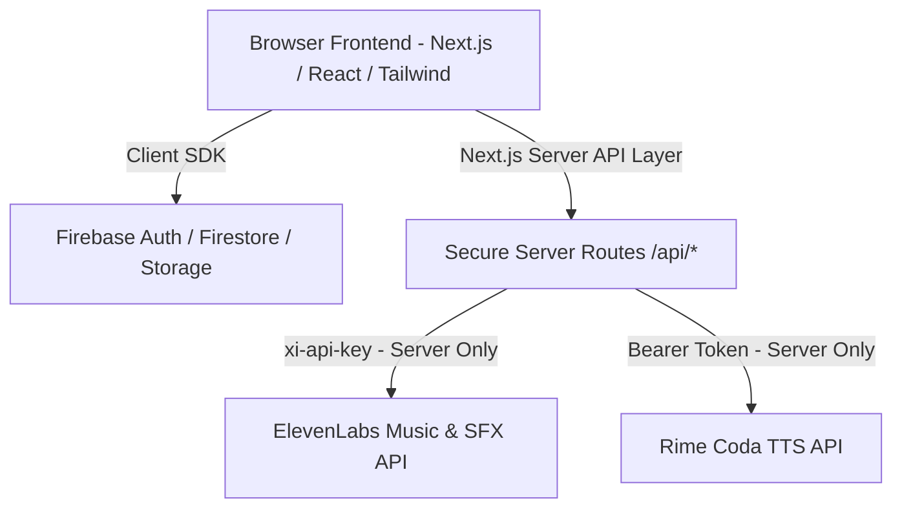

# SONICFORGE AI — Professional AI Music & Sound Studio

> Built for the **GeeksforGeeks Generative AI Clash Hackathon** at **Techno India University School of the Future**.
> Pair-programmed with Google Antigravity.

SONICFORGE AI is a production-grade creative audio SaaS that empowers musicians, game developers, podcasters, and filmmakers to generate original AI music tracks and sound effects with genuine creative control.

---

## 🌟 Key Features

1. **AI Music Studio**
   - Direct server-side integration with official **ElevenLabs Music API** (`music_v2`).
   - Detailed musical parameters: genre, mood, tempo/BPM, multi-instrument selector, target duration (15s–60s), and instrumental toggle.
   - 8 curated production presets (Cinematic Orchestral, Retrowave, Ambient Dreamscape, Lo-Fi Study, Podcast Stingers, Game Boss Battles, and Original Demos).

2. **Sound Effects & Foley Studio**
   - Integrated with official **ElevenLabs Sound Generation API** (`eleven_text_to_sound_v2`).
   - High-precision duration controls, prompt influence slider (0.1 creative to 0.9 literal adherence), and seamless looping for ambient textures.

3. **Sonic Assistant (Voice Copilot)**
   - Conversational music studio assistant for prompt crafting, arrangement planning, and troubleshooting.
   - Real voice output powered by **Rime Coda Text-to-Speech** (`coda.api.rime.ai`) with selectable voice speakers (*Astra*, *Nadi*, *Marcus*).
   - Microphone voice input via browser Speech Recognition with real-time transcription and typed fallback.

4. **Professional Audio Player & Waveforms**
   - Docked audio player with seekable progress, volume slider, mute toggle, and playback speed adjustment (0.5x to 2.0x).
   - **True Web Audio API Waveforms**: decodes actual PCM audio buffers into root-mean-square amplitude peaks instead of synthetic fake animations.
   - One-click MP3 download for all generated tracks.

5. **Audio Library & Project Workspaces**
   - Filter by genre, search by prompt/title, toggle favorites, and sort by date or duration.
   - Project workspaces for grouping film cues, video game levels, or podcast episodes.
   - "Tweak & Regenerate" flow: load any previous generation back into the studio console with one click.

6. **Customer Support & Knowledge Base (Inspired by VeraCost)**
   - Searchable knowledge base addressing API limits, browser autoplay policies, and audio encoding.
   - Secure support ticket submission persisted to Cloud Firestore.
   - Prefilled support email dispatch to `support@sonicforge.ai`.

7. **Zero-Leakage Integration Diagnostics**
   - Live connectivity and schema validation dashboard for Firebase, ElevenLabs, and Rime TTS.
   - Safe, non-destructive checks that never trigger paid audio generation or reveal secret keys.

---

## 🏗️ Architecture & Security Model



- **Client vs. Server Credentials**: Secrets (`ELEVENLABS_API_KEY`, `RIME_TTS_API_KEY`) are stored **strictly in server-only environment variables** and are never exposed in JavaScript client bundles or network responses.
- **Client Firebase Config**: Values prefixed with `NEXT_PUBLIC_FIREBASE_*` are provided to the browser SDK as intended by Firebase, and access is safeguarded by strict Firestore and Storage Security Rules.

---

## 🚀 Beginner Quickstart (Step-by-Step)

### 1. Prerequisites
- **Node.js**: v18 or higher (v20+ recommended)
- **Git**

### 2. Clone and Install Dependencies
In your PowerShell terminal:
```powershell
npm install
```
*(Note: If PowerShell execution policies restrict running npm scripts, use `npm.cmd install`)*

### 3. Environment Configuration
Create a `.env.local` file by copying the template:
```powershell
cp .env.example .env.local
```

Fill in your credentials in `.env.local`:
```env
NEXT_PUBLIC_FIREBASE_API_KEY="your_firebase_api_key"
NEXT_PUBLIC_FIREBASE_AUTH_DOMAIN="your_project_id.firebaseapp.com"
NEXT_PUBLIC_FIREBASE_PROJECT_ID="your_project_id"
NEXT_PUBLIC_FIREBASE_STORAGE_BUCKET="your_project_id.firebasestorage.app"
NEXT_PUBLIC_FIREBASE_MESSAGING_SENDER_ID="your_sender_id"
NEXT_PUBLIC_FIREBASE_APP_ID="your_app_id"
NEXT_PUBLIC_FIREBASE_MEASUREMENT_ID="your_measurement_id"

# Server-side secrets (Never commit these!)
ELEVENLABS_API_KEY="sk_your_elevenlabs_key"
RIME_TTS_API_KEY="your_rime_tts_key"
```

### 4. Run Development Server
```powershell
npm run dev
```
Open [http://localhost:3000](http://localhost:3000) in your web browser.

---

## 🔒 Firebase Setup Instructions

1. **Create Firebase Project**:
   - Go to [Firebase Console](https://console.firebase.google.com/) and create a project named `sonicforge-ai`.
2. **Enable Authentication**:
   - In Firebase Console &rarr; **Build** &rarr; **Authentication** &rarr; **Sign-in method**.
   - Enable **Email/Password**.
   - Enable **Google** (set your project support email and save).
   - In **Authorized domains**, make sure `localhost` and your production deployment domain (e.g. `your-app.vercel.app`) are listed.
3. **Enable Cloud Firestore**:
   - In Firebase Console &rarr; **Build** &rarr; **Firestore Database** &rarr; **Create Database** (Production mode).
   - Deploy the rules provided in `firestore.rules`.
4. **Enable Firebase Storage**:
   - In Firebase Console &rarr; **Build** &rarr; **Storage** &rarr; **Get Started**.
   - Deploy the rules provided in `storage.rules`.

---

## 🚢 Deploying to Vercel

1. Push your repository to GitHub:
   ```powershell
   git add .
   git commit -m "feat: complete SonicForge AI studio implementation"
   git push origin main
   ```
2. Log in to [Vercel](https://vercel.com) and click **Add New Project**.
3. Import your GitHub repository.
4. In the **Environment Variables** section on Vercel, copy all variables from `.env.local`.
5. Click **Deploy**. Your creative AI audio studio will be live!

---

## 🧪 Testing & Verification Checklist

- [x] **Firebase Auth**: Email/password registration, login, Google OAuth, session persistence.
- [x] **ElevenLabs Music**: `/v1/music` server generation with custom parameters & MP3 audio decoding.
- [x] **ElevenLabs Sound Effects**: `/v1/sound-generation` text-to-sound rendering.
- [x] **Rime Coda TTS**: Text-to-speech audio synthesis with speaker selection (`astra`).
- [x] **Web Audio API**: Real waveform peak rendering from raw audio buffers.
- [x] **Sonic Assistant**: Contextual prompt generator with Web Speech API mic transcription.
- [x] **Support Desk**: VeraCost-inspired ticket tracking and support email dispatch.
- [x] **Diagnostics**: Developer health dashboard with non-destructive verification.

